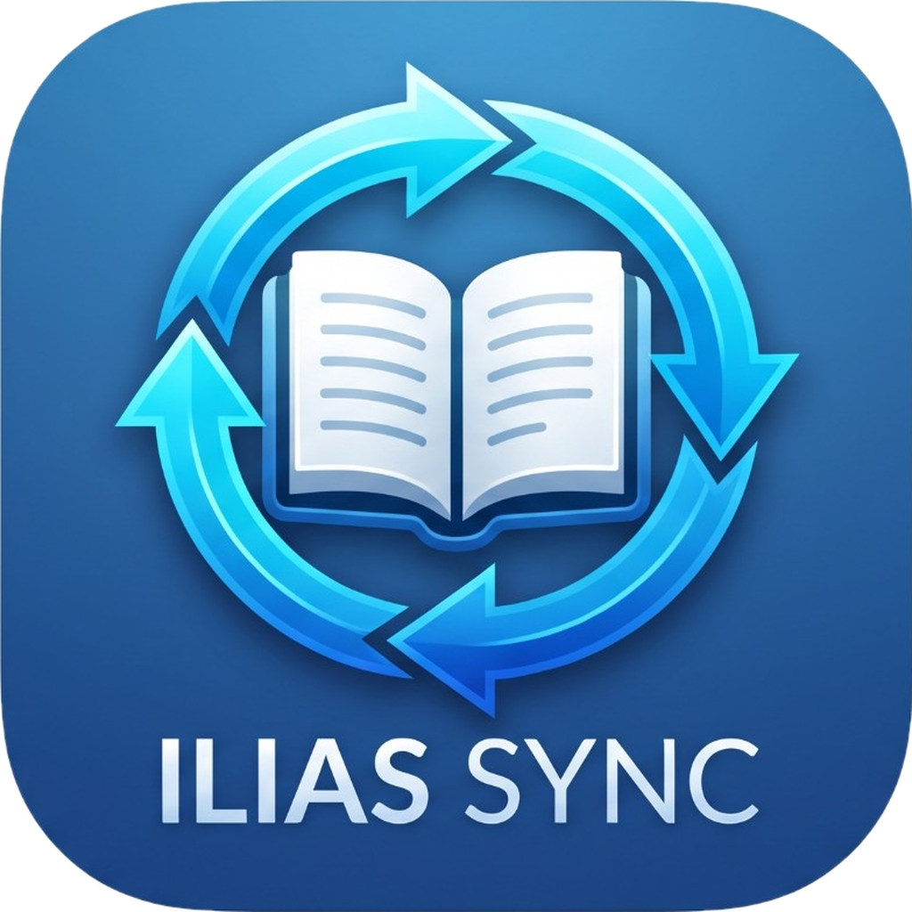
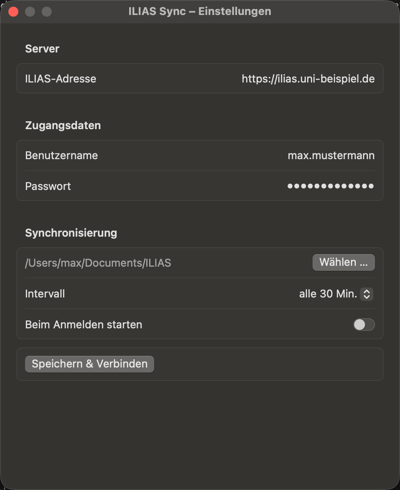

<p align="center"></p>

# ILIAS Sync

**Deutsch** · [English](README.md)

Kleine Menüleisten- bzw. Infobereich-App für **macOS** und **Windows**, die deine Kurse aus einem
[ILIAS](https://github.com/ILIAS-eLearning/ILIAS)-System anzeigt und neue oder geänderte Kursdateien automatisch in
einen Ordner deiner Wahl herunterlädt.

> **Status:** frühe Version (0.2). Bisher nur gegen eine ILIAS-Installation mit dem neueren UI-Framework getestet.
> Andere Versionen und Themes können Anpassungen brauchen.
> Getestet und funktionsfähig unter **macOS** und **Windows**.

**Stichworte:** ILIAS synchronisieren, ILIAS Kurse herunterladen, ILIAS Mac-App, ILIAS Windows-App, ILIAS Dateien
offline, ILIAS Menüleiste, ILIAS Infobereich, E-Learning, Lernplattform, Swift, SwiftUI, C#, WPF.

## Aufbau des Repos

| Ordner | Inhalt |
| --- | --- |
| [`macOS/`](macOS) | macOS-App (Swift, SwiftUI) – Symbol in der Menüleiste |
| [`Windows/`](Windows) | Windows-App (C#, .NET 8, WPF) – Symbol im Infobereich (Tray) |
| [`docs/`](docs) | Screenshots |

Beide Apps tun dasselbe und folgen denselben Sicherheitsregeln.

## Download

Fertige Apps unter **[Releases](https://github.com/dev-prophet-code/ILIASsync/releases/latest)**:

| Plattform | Datei | Hinweise |
| --- | --- | --- |
| macOS 13+ (Apple Silicon & Intel) | `ILIASSync-…-macOS.zip` | Entpacken, `ILIASSync.app` nach „Programme" ziehen. Erster Start: Rechtsklick → **Öffnen** (nicht notarisiert). |
| Windows 10/11 (x64) | `ILIASSync-…-Windows-x64.zip` | Entpacken und `ILIASSync.exe` starten (keine Installation, .NET ist enthalten). SmartScreen kann warnen, weil die Datei nicht signiert ist: **Weitere Informationen → Trotzdem ausführen**. |

## Screenshot

<p align="center"></p>

## Funktionen

- Einrichtung über ein kleines Fenster: Server-Adresse, Benutzername, Passwort, Sync-Ordner, Intervall
- Danach läuft die App nur noch in der Menüleiste (macOS) bzw. im Infobereich (Windows), ohne Dock-Symbol / Taskleistenknopf
- Menü: **Meine Kurse** (öffnet den Kurs im Browser), **Jetzt synchronisieren**, **Sync-Ordner öffnen**, **Einstellungen**
- Lädt Dateien aus Kursen und Unterordnern und bildet die Ordnerstruktur lokal nach
- Einzelne Kurse lassen sich vom Sync ausnehmen
- Hinweis **„Neue Daten synchronisiert“** nach jedem Sync, der neue oder aktualisierte Dateien lädt
- Optional: Start beim Anmelden
- Das Passwort wird sicher gespeichert: macOS-Schlüsselbund bzw. Windows-DPAPI (für dein Benutzerkonto verschlüsselt)

## Sicherheit der lokalen Daten

- Die App **löscht nie** Dateien im Sync-Ordner und **lädt nie etwas hoch**. Sie stellt nur lesende Anfragen an ILIAS
  (außer dem Login).
- Vorhandene Dateien werden per **SHA-256** verglichen. Ist der Inhalt identisch, passiert nichts.
- Ist eine Datei in ILIAS neu hochgeladen worden und weicht von der lokalen ab, wird sie **nicht überschrieben**,
  sondern als `Name (neue Version JJJJ-MM-TT HH-mm).ext` daneben gespeichert.
- Wurde eine Datei in ILIAS gelöscht, bleibt die lokale Kopie erhalten.
- Es werden nur `https://`-Adressen akzeptiert (Zugangsdaten gehen nie unverschlüsselt raus).
- Lehnt ILIAS die Zugangsdaten ab, pausieren die automatischen Syncs, bis du sie neu speicherst – ein falsches Passwort kann dein Konto also nicht sperren.

## Benutzung

1. App starten – beim ersten Mal öffnet sich das Einstellungsfenster.
2. ILIAS-Adresse (z. B. `https://ilias.uni-beispiel.de`), Benutzername und Passwort eintragen, Sync-Ordner wählen.
3. **Speichern & Verbinden**. Die App meldet sich an, zeigt die Zahl der Kurse und startet den ersten Sync.
4. Nach jedem Sync mit neuen oder geänderten Dateien erscheint der Hinweis „Neue Daten synchronisiert“ (unter macOS Mitteilungen erlauben, wenn gefragt).
5. Fenster schließen. Das Symbol bleibt in Menüleiste bzw. Infobereich; die Einstellungen erreichst du über das Menü
   (macOS: auch durch erneutes Starten der App; Windows: Doppelklick auf das Symbol).

## Selbst bauen

### macOS

Benötigt macOS 13+ und Xcode (Lizenz akzeptiert; die SwiftUI-Makros brauchen die Xcode-Toolchain).

```bash
git clone https://github.com/dev-prophet-code/ILIASsync.git
cd ILIASsync/macOS
./build.sh
open build/ILIASSync.app
```

`build.sh` baut universal (arm64 + x86_64), erzeugt `build/ILIASSync.app` (mit Icon, `LSUIElement`) und signiert
ad hoc. Liegt Xcode nicht unter `/Applications/Xcode.app`, setze `DEVELOPER_DIR` entsprechend.
Die App ist nicht notarisiert; für eine Verteilung ohne Gatekeeper-Warnung braucht es eine Apple-Developer-ID.

### Windows

Benötigt das [.NET 8 SDK](https://dotnet.microsoft.com/download) unter Windows 10/11.

```powershell
git clone https://github.com/dev-prophet-code/ILIASsync.git
cd ILIASsync\Windows
.\build.ps1
.\build\ILIASSync.exe
```

`build.ps1` erzeugt eine einzelne, eigenständige `ILIASSync.exe` (win-x64). Zum Entwickeln genügt auch `dotnet run`
im Ordner `Windows`. Die exe ist nicht signiert, SmartScreen warnt daher auf fremden Rechnern.

## Wie es funktioniert

ILIAS bietet ohne Admin-Setup keine einfache Schnittstelle für Nutzer. Die Apps melden sich deshalb wie ein Browser
über das Login-Formular an, lesen „Meine Kurse" (`ilmembershipoverviewgui`, Fallback Dashboard) aus und durchlaufen
Kurse und Ordner über `goto.php?target=…`. Dateien werden über `goto.php?target=file_<id>_download` geladen.
Die Änderungserkennung nutzt `Last-Modified`/`Content-Length` und den SHA-256-Hash.

Lokaler Sync-Status: macOS `~/Library/Application Support/ILIASSync/state.json`,
Windows `%APPDATA%\ILIASSync\state.json`.

## Änderungen

- **0.2.0** – Hinweis „Neue Daten synchronisiert“; nur https; automatische Syncs pausieren nach abgelehnten Zugangsdaten; HTTP-Fehler und abgelaufene Sitzungen werden gemeldet statt „Alles aktuell“; weniger doppelte Downloads (macOS: eine Anfrage, versionierte Dateien nicht mehr neu geladen); Windows: Zweitstart wirft keine Exception mehr. Getestet unter macOS und Windows.
- **0.1.0** – Erste Version.

## Bekannte Einschränkungen

- Kein Single-Sign-on (Shibboleth, CAS, …), nur Anmeldung mit Benutzername und Passwort
- Es werden nur Dateien geladen, keine Lernmodule, Foren, Links oder Gruppenordner
- Das Auslesen der HTML-Seiten kann bei anderen ILIAS-Versionen/Themes abweichen
- Windows: sehr lange Pfade (> 260 Zeichen) können fehlschlagen, wenn lange Pfade in Windows nicht aktiviert sind

## Lizenz

[Apache License 2.0](LICENSE)
